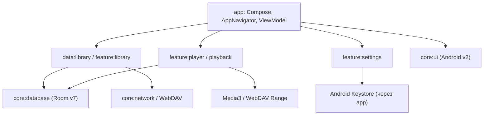

# Архитектура enoTone Android

**Фактический срез:** 2026-11-22 · `main` `0f5e988174f0d697327ef7a3d242d417eaf02c8d` · версия `0.6.2`. Структура сверена с `settings.gradle.kts` и `app/build.gradle.kts`; детали контрактов — [MODULE_MAP](MODULE_MAP.md), [CURRENT_DECISIONS](CURRENT_DECISIONS.md), [индекс ADR](DECISIONS/README.md). Тулчейн — Gradle 9.9.1 / AGP 9.5.1 / compileSdk 37 ([ADR-0100](DECISIONS/ADR-0100-gradle9-agp9-compilesdk37.md)).

## Общая схема

Нативное приложение Kotlin/Jetpack Compose, ручная сборка зависимостей через `AppContainer`, ViewModel и `StateFlow`. HTTPS WebDAV — источник музыки; Room — локальный каталог, метаданные и модель плейлистов; очередь/позиция сохраняются отдельным механизмом; Media3 ExoPlayer с MediaSessionService — воспроизведение. UI не должен запускать WebDAV/долгую индексацию непосредственно из Composable. Пароли и персональные пути не пишутся в Room, Intent, логи или Git.

Эта схема **логическая**, а не строгий список прямых Gradle-зависимостей. Реальные `include(...)` определяются `settings.gradle.kts`, точные точки входа — в [MODULE_MAP](MODULE_MAP.md).

## Подключённые модули

| Модуль | Ответственность |
|---|---|
| `:app` | Activity, `AppContainer`, сервисные/Android-адаптеры, маршруты, оставшиеся resource-bound экраны, ViewModel и связывание компонентов |
| `:core:model` | Общие модели и контракты без Android UI |
| `:core:database` | Room v7, DAO, миграции и экспортируемые схемы |
| `:core:network` | WebDAV PROPFIND и диагностика сетевого уровня |
| `:core:ui` | Токены, тема и stateless-компоненты Android v2, снимки Roborazzi |
| `:data:library` | Каталог, тег-парсер MP3/FLAC, Range-reader, группировка и индексирование |
| `:data:playlist` | Хранилище плейлистов и «Избранного»; публичный UI отсутствует |
| `:playback` | MediaSessionService, ExoPlayer, WebDAV DataSource, временный кэш и очередь |
| `:feature:library` | Выделенные из `app` компоненты медиатеки и обложек |
| `:feature:player` | Компоненты экрана «Сейчас играет» |
| `:feature:settings` | Отдельные возможности настроек и санитизация диагностики |

Ранее планировавшиеся пустые `:core:common`, `:core:datastore`, `:data:source`, `:data:cache` и `:feature:ai` **не подключены**. Они не должны упоминаться как реализованные модули.

## Потоки данных и жизненный цикл

1. **Каталог и теги.** По явному действию импорт/обновление запрашивает `PROPFIND Depth: 1` для плоской `/AllMusic`, атомарно обновляет Room, затем обрабатывает MP3/FLAC новых/изменённых файлов. Полная переиндексация — отдельное подтверждаемое действие; при ошибке старые теги не стираются. [ADR-0066](DECISIONS/ADR-0066-indexing-finalization.md).
2. **Поиск.** FTS4 удалён из UI и БД (#143): Room **v7**, подготовленные при загрузке медиатеки ключи и поиск в памяти. Русская сортировка и ё/е не зависят от FTS4. [ADR-0091](DECISIONS/ADR-0091-no-fts-memory-search.md). Аппаратные SRCH-05/07 ещё ожидают проверки.
3. **Обложки.** Один WebP-мастер до 1200 px в `filesDir/enotone-artwork-v2`, дедупликация; хранение не равно временному аудиокэшу. Режимы `ON_DEMAND` и `AUTO_AFTER_IMPORT`; без массового image GET при сканировании тегов. [ADR-0067](DECISIONS/ADR-0067-permanent-album-artwork.md).
4. **Воспроизведение.** `:playback` владеет Media3/MediaSession, очередью, seek, repeat/shuffle, временным кэшем и одной предзагрузкой next; `PlayerViewModel` предоставляет снимок состояния экрану. Очередь/позиция сохраняются, но постоянная загрузка музыки offline и экран редактирования очереди не реализованы.
5. **Аккаунт и выход.** `app` использует Android Keystore AES-GCM после успешной проверки WebDAV. Выход сначала прекращает воспроизведение/фоновые операции, затем очищает пользовательские данные и только последним — Keystore. [ADR-0080](DECISIONS/ADR-0080-permanent-login-sign-out.md).
6. **UI/Back.** `AppNavigator` управляет вкладками, деталями, настройками/диагностикой; нижняя панель и мини-плеер остаются смонтированы под цельной шторкой полного плеера. D5-C (#183) добавил общий лист действий «⋮» с навигацией к альбому/исполнителю и единый Snackbar поверх плеера; в остальном жизненный цикл D3.5 сохранён. D3.5 использует один fade-through без горизонтального slide/shared artwork, Back: PLAYER → OVERLAY → DETAIL → SEARCH → TAB → EXIT. [ADR-0086](DECISIONS/ADR-0086-navigation-shell-v2.md), [ADR-0095](DECISIONS/ADR-0095-simple-motion.md).

## Дизайн, тесты и границы

Единственный действующий источник дизайн-ресурсов/эталонов — [`design/`](../design/README.md) **в этом репозитории**; перенос ресурсов — только `design/tools/sync_android.py` ([ADR-0090](DECISIONS/ADR-0090-design-in-app-repo.md)). Визуальное руководство — [ADR-0084](DECISIONS/ADR-0084-android-v2-design-system.md); Graphite Material 3 (ADR-0073) и ранние концепции заменены.

Проверки: JUnit, Robolectric/Compose UI, Roborazzi, detekt/ktlint, Room schema, контроль GMS и синхронизации дизайна ([TESTING](TESTING.md)). CI подтверждает только автоматические свойства; результат Huawei — исключительно [SCENARIOS](SCENARIOS.md). Остаются отдельные вопросы унификации трёх сетевых стеков, работы на Windows, восстановления после ошибок и offline-функций ([KNOWN_ISSUES](KNOWN_ISSUES.md)).
