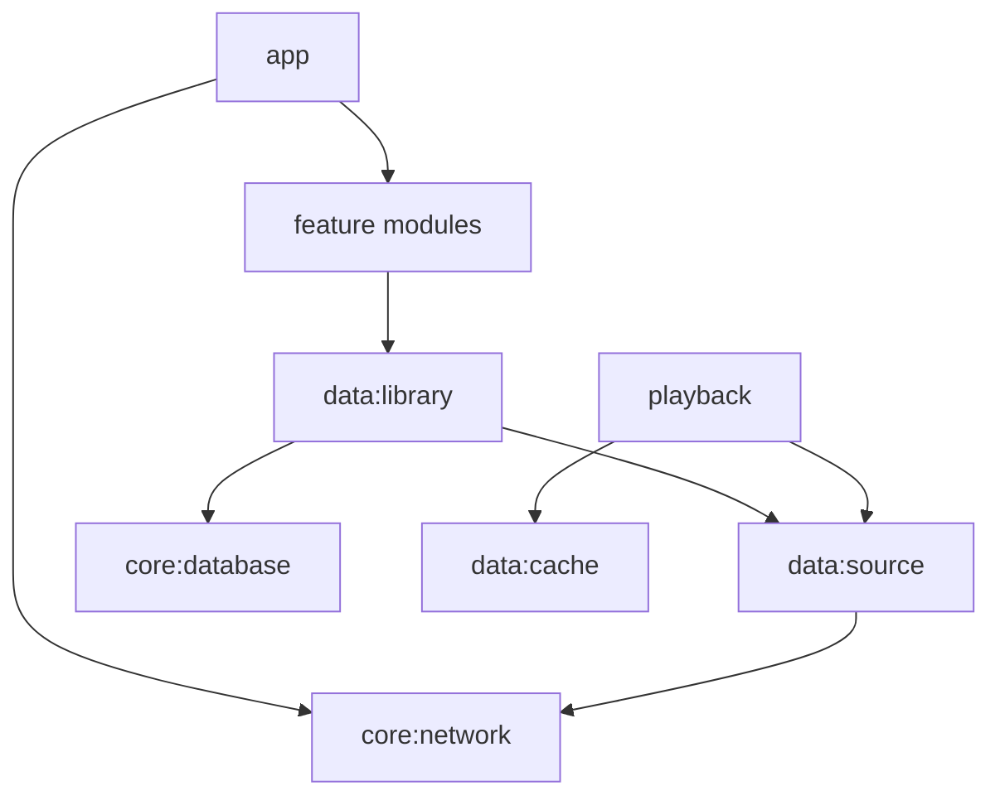

# Архитектура

Нативный Kotlin + Compose. **Media3 ExoPlayer и MediaSessionService уже работают** в `:playback` (M3–M5); источник WebDAV через строго проверяемый HTTPS/Range DataSource, локальная Room — источник истины перечня/тегов. Фактические транспорт и ограничения фиксируются в ADR и `docs/STATUS.md`; прежний список зависимостей был только архитектурным предложением. Бизнес-логику держим вне Composable, UI строится реактивно.

Плановые модули: `:app`, `:core:common`, `:core:model`, `:core:database`, `:core:network`, `:core:datastore`, `:data:library`, `:data:source`, `:data:cache`, `:data:playlist`, `:playback`, `:feature:library`, `:feature:player`, `:feature:settings`, `:feature:ai`.

**Конкретная структура основной библиотеки, подтверждена владельцем 2026-11-08:** `/AllMusic` содержит файлы непосредственно внутри, **без вложенных директорий**. В M1 достаточно одного `PROPFIND Depth: 1` для `/AllMusic`, с разбором `207 Multi-Status`. Рекурсивный обход, `Depth: infinity` и параллельное сканирование дерева **не требуются**. Если сервер всё же вернул элемент-папку — не переходить внутрь, зарегистрировать диагностическое отклонение. Артисты/альбомы формируются из тегов, а не структуры каталогов. Интерфейс `MusicSource` сохраняет расширяемость для других источников, но без реализации ненужной рекурсии в M1.

Абстракция `MusicSource` в M1 предоставляет список, metadata, range-read и обложки; WebDAV — основной адаптер, SAF — опциональный. Стойкий `trackId` от source и нормализованного NFC-пути, изменение ETag сохраняется как версия, переименование требует тестируемой эвристики. Модули на M0 могут быть пустыми каркасами: это **не** реализация функций.

## Фактические срезы к 2026-11-09
- Один PROPFIND Depth: 1 заполняет Room без рекурсии (3590 файлов на устройстве). Быстрое чтение MP3/FLAC и ручные 10/20 пилоты не равны массовому завершению M1.
- Экран «Треки» с поиском уже существует; альбомы/артисты/FTS/обложки ещё не реализованы, несмотря на наличие модулей-каркасов.
- Media3 MediaSessionService владеет очередью и shuffle/repeat, staged seed ограничивает время первого старта. Текущий и один следующий файл временно кэшируются последовательно. Состояние после гибели процесса ещё не сохраняется.
- Seek-ползунок и проверенные переходы уже в main: PR #30, Huawei Preview #157, зелёный CI #157. Нулевой HTTP GET при seek/gapless отдельно не измерялись.
- Стандартная MaterialTheme: собственные цвета/маскот Android пока не согласованы.

Актуальный список принятых/неполных этапов: [ROADMAP](ROADMAP.md). Решения и неизвестные: [DECISIONS](DECISIONS), [KNOWN_ISSUES](KNOWN_ISSUES.md).
