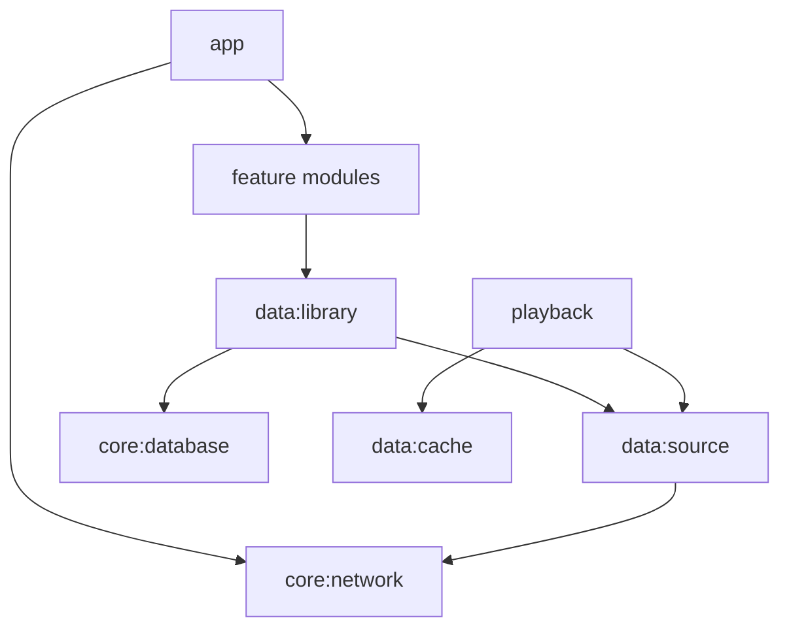

# Архитектура

Нативный Kotlin + Compose, AndroidX Media3 в будущем M3, OkHttp для WebDAV, Room как единый источник истины медиатеки с M1. Бизнес-логика вне Composable, UDF + StateFlow.

Плановые модули: `:app`, `:core:common`, `:core:model`, `:core:database`, `:core:network`, `:core:datastore`, `:data:library`, `:data:source`, `:data:cache`, `:data:playlist`, `:playback`, `:feature:library`, `:feature:player`, `:feature:settings`, `:feature:ai`.

**Конкретная структура основной библиотеки, подтверждена владельцем 2026-11-08:** `/AllMusic` содержит файлы непосредственно внутри, **без вложенных директорий**. В M1 достаточно одного `PROPFIND Depth: 1` для `/AllMusic`, с разбором `207 Multi-Status`. Рекурсивный обход, `Depth: infinity` и параллельное сканирование дерева **не требуются**. Если сервер всё же вернул элемент-папку — не переходить внутрь, зарегистрировать диагностическое отклонение. Артисты/альбомы формируются из тегов, а не структуры каталогов. Интерфейс `MusicSource` сохраняет расширяемость для других источников, но без реализации ненужной рекурсии в M1.

Абстракция `MusicSource` в M1 предоставляет список, metadata, range-read и обложки; WebDAV — основной адаптер, SAF — опциональный. Стойкий `trackId` от source и нормализованного NFC-пути, изменение ETag сохраняется как версия, переименование требует тестируемой эвристики. Модули на M0 могут быть пустыми каркасами: это **не** реализация функций.
