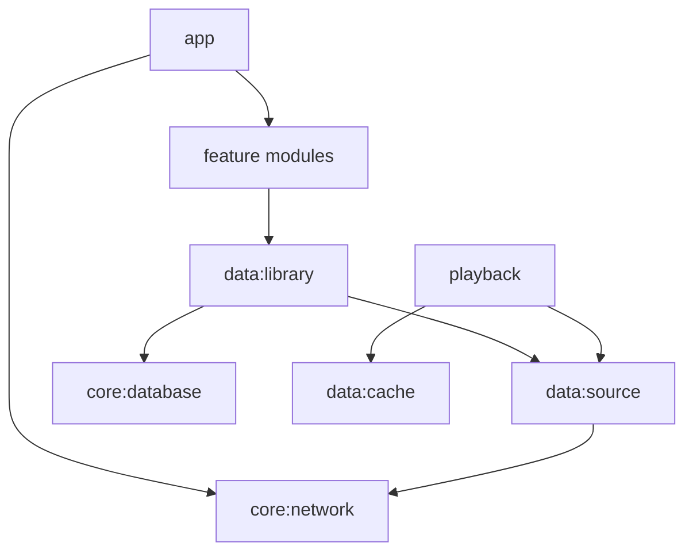

> **Актуальность 2026-11-11, Stable Preview #301:** действуют [CURRENT_DECISIONS](CURRENT_DECISIONS.md), [ADR-0066](DECISIONS/ADR-0066-indexing-finalization.md) и [ADR-0067](DECISIONS/ADR-0067-permanent-album-artwork.md). Далее есть сохранённые исторические срезы M0–M6, в том числе утверждения об отсутствии альбомов/артистов/обложек — **они не описывают текущий `main`**. M1 Room v4, отдельные разделы Album/Artist/Album Artist и Now Playing работают; пользователь принял базовую Stable Preview #301 на Huawei.

# Архитектура

Нативный Kotlin + Compose. **Media3 ExoPlayer и MediaSessionService уже работают** в `:playback` (M3–M5); источник WebDAV через строго проверяемый HTTPS/Range DataSource, локальная Room — источник истины перечня/тегов. Фактические транспорт и ограничения фиксируются в ADR и `docs/STATUS.md`; прежний список зависимостей был только архитектурным предложением. Бизнес-логику держим вне Composable, UI строится реактивно.

## Фактическое состояние модулей (аудит 2026-11-11)

Целевая схема ниже реализована **не полностью**. Код есть только в пяти модулях:

| Модуль | Содержимое |
|---|---|
| `:app` | весь UI (Compose), навигация, настройки (`SharedPreferences`), сервисы индексации и обложек, `ArtworkPreviewRepository`, хранилище входа |
| `:core:network` | плоский PROPFIND и диагностика (Ktor CIO), парсер multistatus |
| `:core:database` | Room v4: одна таблица `remote_tracks` |
| `:data:library` | Range-reader (HttpURLConnection), парсер тегов MP3/FLAC, индексаторы, группировка медиатеки |
| `:playback` | MediaSessionService, ExoPlayer, WebDAV DataSource (HttpsURLConnection), временный кэш |

Пустые (только `build.gradle.kts`): `:core:common`, `:core:model`, `:core:datastore`, `:data:source`, `:data:cache`, `:data:playlist`, `:feature:library`, `:feature:player`, `:feature:settings`, `:feature:ai`. Нет ViewModel и DI; Composable обращаются к Room и сети напрямую. Приведение к целевой схеме — этап M6-0 ([ADR-0074](DECISIONS/ADR-0074-m6-0-tech-debt-plan.md)).

## Целевая схема

Плановые модули: `:app`, `:core:common`, `:core:model`, `:core:database`, `:core:network`, `:core:datastore`, `:data:library`, `:data:source`, `:data:cache`, `:data:playlist`, `:playback`, `:feature:library`, `:feature:player`, `:feature:settings`, `:feature:ai`.

**Конкретная структура основной библиотеки, подтверждена владельцем 2026-11-08:** `/AllMusic` содержит файлы непосредственно внутри, **без вложенных директорий**. В M1 достаточно одного `PROPFIND Depth: 1` для `/AllMusic`, с разбором `207 Multi-Status`. Рекурсивный обход, `Depth: infinity` и параллельное сканирование дерева **не требуются**. Если сервер всё же вернул элемент-папку — не переходить внутрь, зарегистрировать диагностическое отклонение. Артисты/альбомы формируются из тегов, а не структуры каталогов. Интерфейс `MusicSource` сохраняет расширяемость для других источников, но без реализации ненужной рекурсии в M1.

Абстракция `MusicSource` в M1 предоставляет список, metadata, range-read и обложки; WebDAV — основной адаптер, SAF — опциональный. Стойкий `trackId` от source и нормализованного NFC-пути, изменение ETag сохраняется как версия, переименование требует тестируемой эвристики. Модули на M0 могут быть пустыми каркасами: это **не** реализация функций.

## Действующая архитектура M1/M2 — 2026-11-11

- **Одна пользовательская команда импорта/обновления**: WebDAV `PROPFIND Depth:1` плоской папки `/AllMusic` → атомарный Room v4 snapshot → существующий ограниченный фоновый MP3/FLAC reader только для новых/изменённых/незавершённых файлов; TITLE, ARTIST, ALBUM, ALBUM ARTIST, YEAR, DISC, TRACK и GENRE читаются совместно. Принудительная переиндексация — отдельная подтверждаемая операция, без очистки старых тегов при ошибках; backend поддерживает области Album/Artist/Album Artist, меню будут позже.
- **Обложки не хранятся в Room** и не подменяют теги. `ArtworkPreviewRepository` в `:app` держит **один сжатый мастер до 1200 px** в `filesDir/enotone-artwork-v2`, content-addressed WebP blob + хэшированные ссылки на версию аудиоисточника и выбор альбома. Нет автоматического дискового LRU/лимита 64 МиБ. Ранее загруженные временные мастера из `cacheDir` мигрируют лениво; экранные меньшие Bitmap — только ограниченный RAM LRU.
- `AlbumArtworkCatalog` на основе `OfflineLibraryGrouping` выбирает **общую картинку реального альбома** для плитки/деталей/треков/mini/Now Playing. У `Unknown Album` трековые картинки самостоятельны. Кэш совпадающих изображений дедуплицируется по реальному содержимому, а не по совпадению названия альбома. `ArtworkIndexingForegroundService` обслуживает **опциональный** автоматический режим после чтения тегов; альтернативный ON_DEMAND — по видимости/воспроизведению. Текстовые теги не тянут APIC/PICTURE массово.
- Для будущих плейлистов **запланирована ссылка на существующий мастер альбома** без второй копии файла; пользовательские модели/экраны назначения обложки **не реализованы**. Временный Media3 аудиокэш current/next остаётся отдельным и не становится постоянным.
- Проверка: exact-HEAD CI #300, подписанный `main` CI #301, ответ владельца «Работает» на Huawei. Детальные offline/GET/pause/clear сценарии перечислены в [TESTING](TESTING.md) и не считаются подтверждёнными только этим ответом.

## Исторические фактические срезы к 2026-11-09
- Один PROPFIND Depth: 1 заполняет Room без рекурсии (3590 файлов на устройстве). Быстрое чтение MP3/FLAC и ручные 10/20 пилоты не равны массовому завершению M1.
- Экран «Треки» с поиском уже существует; альбомы/артисты/FTS/обложки ещё не реализованы, несмотря на наличие модулей-каркасов.
- Media3 MediaSessionService владеет очередью и shuffle/repeat, staged seed ограничивает время первого старта. Текущий и один следующий файл временно кэшируются последовательно. Состояние после гибели процесса ещё не сохраняется.
- Seek-ползунок и проверенные переходы уже в main: PR #30, Huawei Preview #157, зелёный CI #157. Нулевой HTTP GET при seek/gapless отдельно не измерялись.
- Стандартная MaterialTheme: собственные цвета/маскот Android пока не согласованы.

Актуальный список принятых/неполных этапов: [ROADMAP](ROADMAP.md). Решения и неизвестные: [DECISIONS](DECISIONS), [KNOWN_ISSUES](KNOWN_ISSUES.md).
