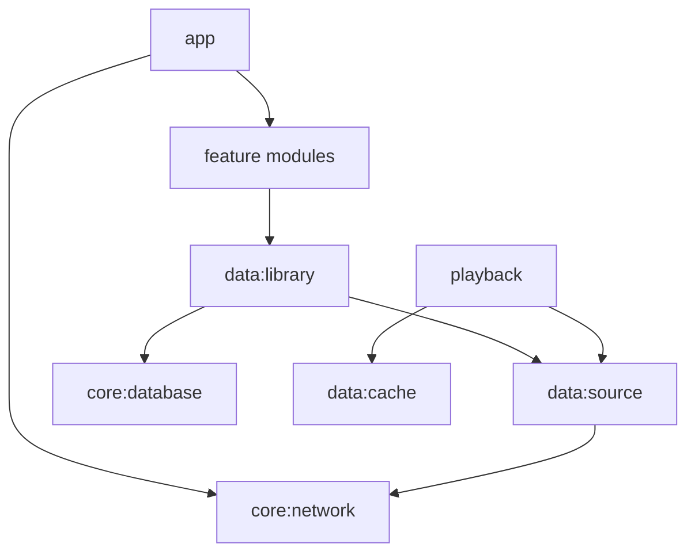

# Архитектура

Нативный Kotlin + Compose, AndroidX Media3 в будущем M3, OkHttp для WebDAV, Room как единый источник истины медиатеки с M1. Бизнес-логика вне Composable, UDF + StateFlow.

Плановые модули: `:app`, `:core:common`, `:core:model`, `:core:database`, `:core:network`, `:core:datastore`, `:data:library`, `:data:source`, `:data:cache`, `:data:playlist`, `:playback`, `:feature:library`, `:feature:player`, `:feature:settings`, `:feature:ai`.

Абстракция `MusicSource` в M1 предоставляет список, metadata, range-read и обложки; WebDAV — основной адаптер, SAF — опциональный. Стойкий `trackId` от source и нормализованного NFC-пути, изменение ETag сохраняется как версия, переименование требует тестируемой эвристики. Модули на M0 могут быть пустыми каркасами: это **не** реализация функций.
